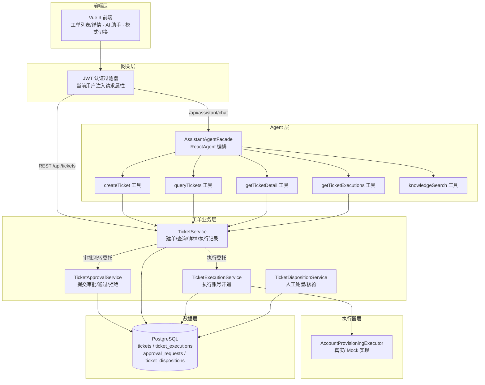
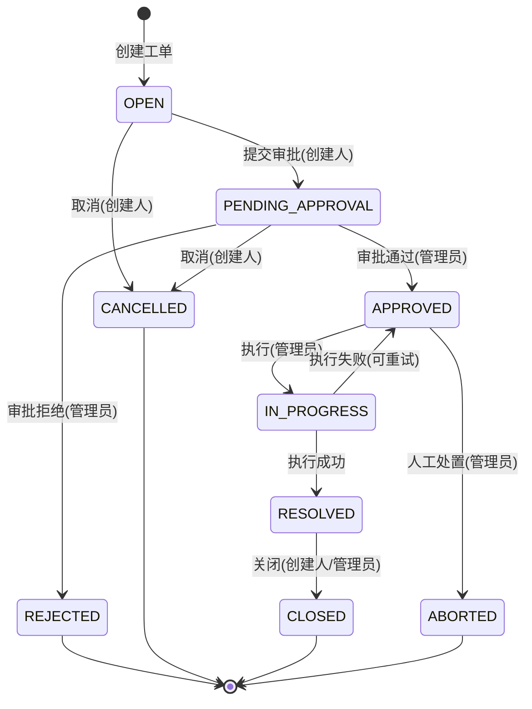

# 工单模块 · 设计与架构

> 本文档是二次开发新增「智能工单处理与受控执行平台」的工单后端设计说明，覆盖整体架构、状态机、数据模型与关键可靠性设计。配套文档见 `演示脚本.md`（演示）与 README（启动/API）。

---

## 1. 模块定位

在原有 Argus RAG/Agent 平台之上，新增一个**受控的业务执行闭环**：Agent 用自然语言理解用户意图并调用工单工具，工单后端用**确定性规则**（状态机、权限校验、幂等、乐观锁、审计）保证操作安全、可追踪，不依赖模型判断。

核心原则：**Agent 只做"智能决策"，后端只认"服务端规则"**。Agent 不直接访问数据库，也不能自行决定权限或绕过审批。

---

## 2. 整体架构

**调用链**：用户提问 → Agent 识别意图并抽取字段 → 调用工单工具 → 工具委托工单业务层 → 服务端执行权限/状态/幂等校验 → 状态机流转 + 执行器执行 + 审计落库 → Agent 返回真实结果。

---

## 3. 工单状态机

9 个状态，状态流转在服务层强校验，非法转换直接抛业务异常。

| 状态 | 含义 |
|---|---|
| OPEN | 已创建，尚未提交审批 |
| PENDING_APPROVAL | 待审批 |
| APPROVED | 已审批通过，业务尚未执行 |
| IN_PROGRESS | 执行中 |
| RESOLVED | 已解决（需结合执行记录解释结果） |
| CLOSED | 已关闭 |
| REJECTED | 审批被拒绝 |
| CANCELLED | 已取消 |
| ABORTED | 经管理员处置后终止，区别于普通取消 |

---

## 4. 数据模型（4 张表，Flyway 迁移管理）

> 迁移文件：`Argus-backend/src/main/resources/db/migration/V1__create_ticket_tables.sql`、`V2__ticket_manual_disposition.sql`。

### 4.1 tickets（工单主表）

| 字段 | 类型 | 说明 |
|---|---|---|
| id | BIGINT PK | 自增主键 |
| ticket_no | VARCHAR(64) UNIQUE | 工单号 |
| title / description | VARCHAR(200) / TEXT | 标题 / 申请原因 |
| type | VARCHAR(32) | 工单类型（如 ACCOUNT_PROVISIONING） |
| status | VARCHAR(32) | 状态，存 `TicketStatus.name()` |
| priority | VARCHAR(16) | 优先级 |
| creator_user_id | BIGINT | 创建人（**取自登录态，不信任 Agent 传入**） |
| assignee_user_id | BIGINT | 处理人，NULL=未分配 |
| approver_user_id | BIGINT | 审批人 |
| system_name | VARCHAR(100) | 目标系统 |
| target_username | VARCHAR(100) | 目标用户名 |
| permission_level | VARCHAR(32) | READ_ONLY / STANDARD / ADMIN |
| version | INT DEFAULT 0 | **乐观锁版本号** |
| idempotency_key | VARCHAR(128) UNIQUE | **建单幂等键（全局唯一）** |
| extra_attempts | INT DEFAULT 0 | 受控重试授权额度（仅人工处置递增） |
| created_at / updated_at | TIMESTAMP | 审计时间 |

### 4.2 ticket_executions（执行记录，append-only）

每次执行尝试**独立一行**，绝不覆盖失败记录。

| 字段 | 说明 |
|---|---|
| id | 主键 |
| ticket_id | 关联工单 |
| execution_type | 执行类型（如 PROVISION_ACCOUNT） |
| result | PENDING / SUCCESS / FAILED / UNCERTAIN |
| error_message | 异常信息 |
| request_payload / response_payload | 请求/响应快照（敏感信息脱敏） |
| attempt_no | 第几次尝试（从 1 起） |
| idempotency_key | 业务操作幂等键（**可多行**） |
| verification_status | 人工核验结论（NULL=未核验；CONFIRMED_SUCCESS / CONFIRMED_NOT_EXECUTED） |
| verified_by / verified_at | 核验人 / 核验时间 |

> 唯一约束 `(idempotency_key, attempt_no)`：同一业务操作每次重试唯一，从而能记录多次重试历史，而不是让幂等键全局唯一。

### 4.3 approval_requests（审批记录，审计）

| 字段 | 说明 |
|---|---|
| id / ticket_id | 主键 / 关联工单 |
| approver_user_id | 审批人 |
| result | PENDING / APPROVED / REJECTED |
| comment | 审批意见 |
| decided_at / created_at / updated_at | 时间 |

### 4.4 ticket_dispositions（人工处置审计，不可变追加）

| 字段 | 说明 |
|---|---|
| id / ticket_id | 主键 / 关联工单 |
| execution_id | 指向被核验的执行记录（CONFIRM_* 时） |
| disposition_type | 处置类型（`DispositionType.name()`） |
| reason | 处置原因（**必填**） |
| operator_user_id | 操作人（取自登录态） |
| from_status / to_status | 处置前后状态 |
| created_at | 时间 |

**表关系**：`tickets 1—N ticket_executions / approval_requests / ticket_dispositions`；`ticket_dispositions.execution_id → ticket_executions.id`（核验场景）。

---

## 5. 关键可靠性设计

### 5.1 幂等：建单与执行分别设计

- **建单幂等**：`tickets.idempotency_key` 全局唯一。重复提交同一建单请求 → 服务端识别已存在，返回"已存在"而非重复建单，**重复业务副作用为零**。
- **执行幂等**：`ticket_executions(idempotency_key, attempt_no)` 唯一。重试允许产生新 attempt 行（`attempt_no + 1`），既防重复执行又保留每次尝试记录。

### 5.2 乐观锁

`tickets.version` 乐观锁版本号，状态流转/并发更新时校验，冲突即失败，防止并发覆盖。

### 5.3 审批与执行分离

- `result` 保存**执行器原始结论**（SUCCESS/FAILED/UNCERTAIN）；`verification_status` 单独保存**人工核验结论**（CONFIRMED_SUCCESS / CONFIRMED_NOT_EXECUTED）。两个维度互不覆盖。
- 执行结果 `UNCERTAIN`（不确定）时，服务端禁止再次执行，必须先人工核验——避免"不确定"被误当失败自动重试。

### 5.4 执行记录 append-only

执行记录只追加不覆盖，失败、重试、核验全部可追溯。

### 5.5 权限边界

- 创建人 / 审批人 / 执行人 / 处置人**一律取自服务端登录态**，请求体不接受任何身份字段。
- 审批通过 / 拒绝、执行、处置仅系统管理员；取消 / 提交审批仅创建人；关闭为创建人或管理员。
- Agent 的提示词**不替代服务端校验**——所有权限与状态判断以后端为准。

---

## 6. Agent 工单工具（能力边界）

| 工具 | 作用 | 模式 |
|---|---|---|
| createTicket | 用自然语言建单（初始 OPEN） | TICKET_ASSIST |
| queryTickets | 查当前用户可见工单列表 | TICKET_QUERY / TICKET_ASSIST |
| getTicketDetail | 查单条工单详情 | TICKET_QUERY / TICKET_ASSIST |
| getTicketExecutions | 查单条工单执行历史 | TICKET_QUERY / TICKET_ASSIST |
| knowledgeSearch | 知识库检索证据 | KB_SEARCH |

Agent 在工单域**只能建单 + 只读查询**，没有任何工具能提交审批、审批、执行、关闭或取消——这些只能走前端 REST 接口 + 服务端校验。
